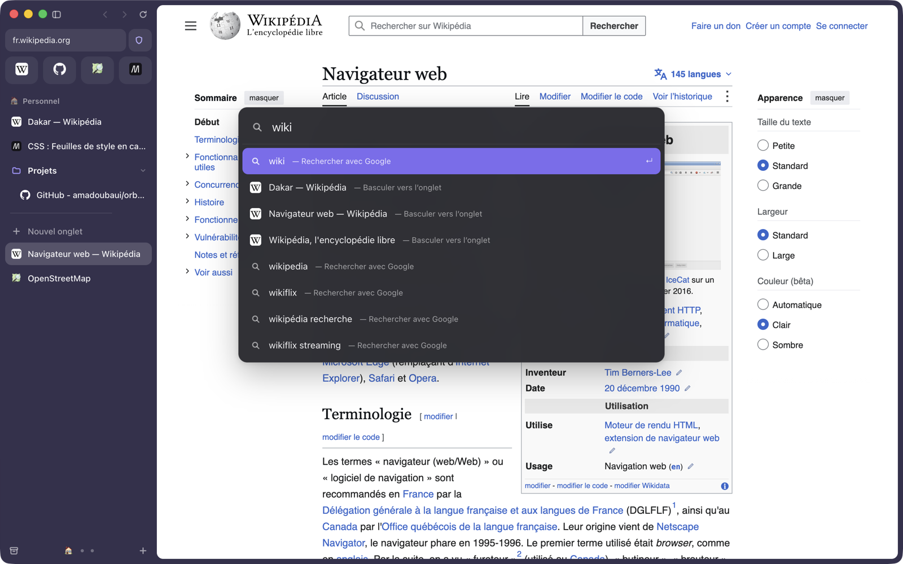
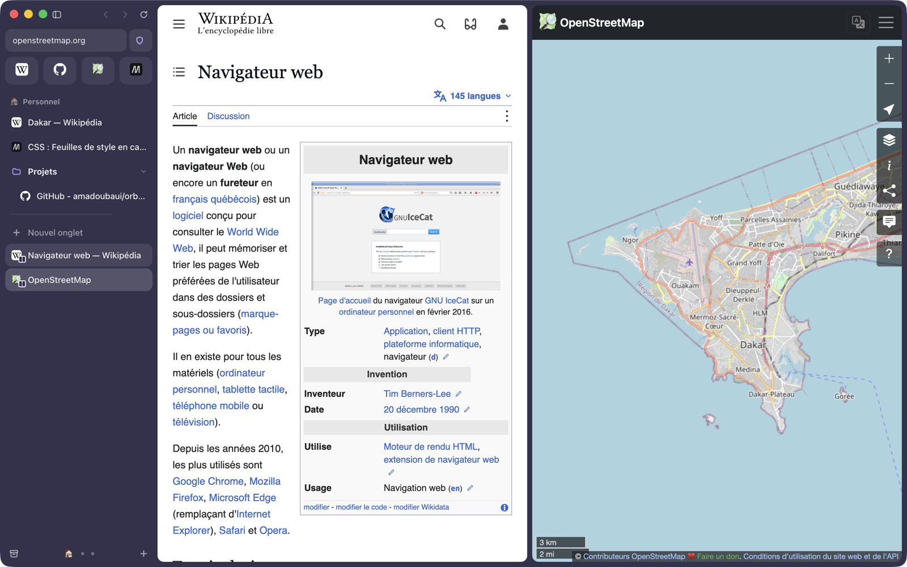
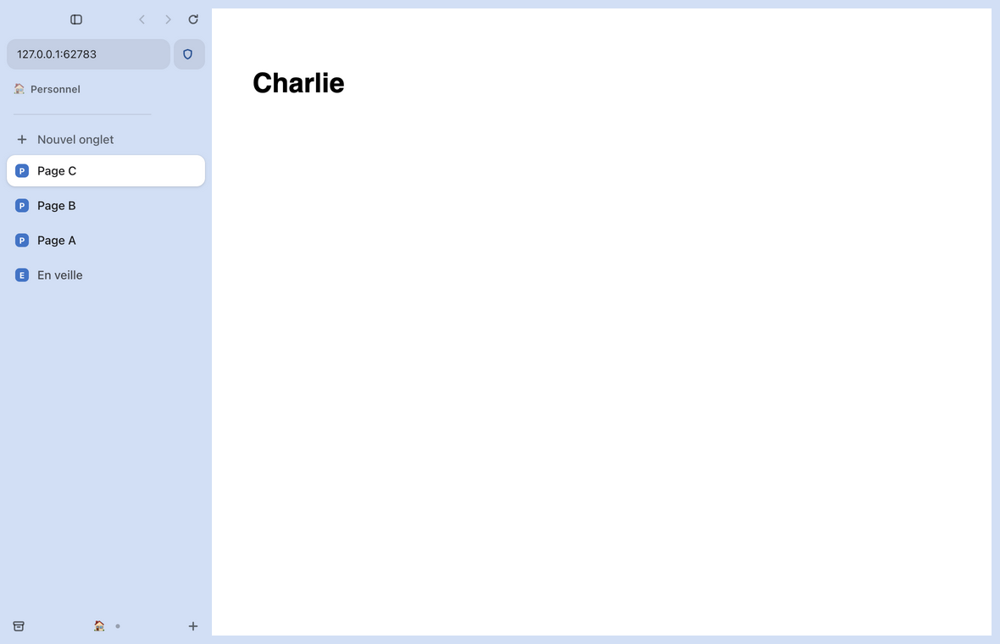
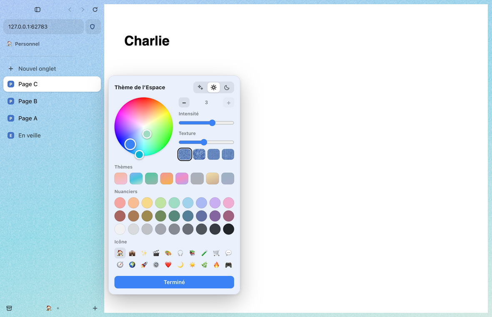
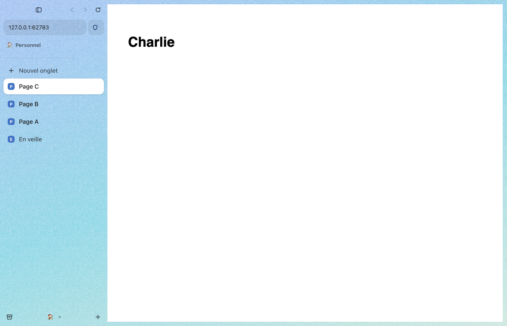
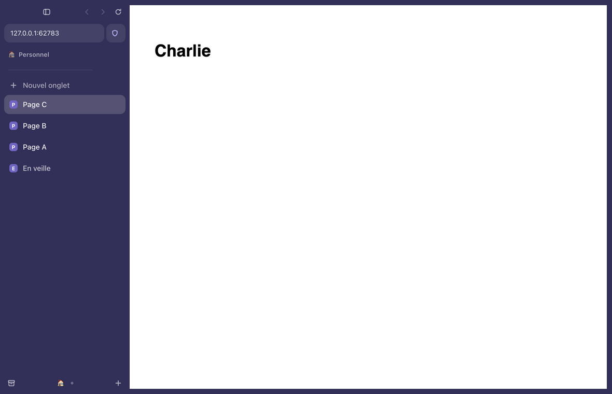

# Orbe

**Un navigateur à barre latérale, en français, bâti sur Chromium.**

Orbe reprend l'organisation et les raccourcis clavier du navigateur Arc — barre
latérale, Espaces, onglets épinglés, barre de commande, vue scindée — avec une
interface entièrement en français (anglais disponible dans les réglages).

> Projet libre et indépendant, sans lien avec The Browser Company. Orbe ne
> contient aucun code ni aucune ressource d'Arc : tout est réécrit.

État : **version 0.15, macOS et Windows**. La version Windows est validée en intégration continue, pas encore essayée sur une machine réelle : voir [docs/windows.md](docs/windows.md).



| Vue scindée | Thème clair |
| --- | --- |
|  |  |

| Éditeur de thème | Dégradé de trois couleurs et grain |
| --- | --- |
|  |  |

| Thème clair | Thème sombre |
| --- | --- |
|  |  |

## Ce qui fonctionne

- **Barre latérale** : favoris en tuiles, onglets épinglés, dossiers, onglets du
  jour, glisser-déposer, renommage sur place, largeur réglable, masquage (⌘S)
  avec réapparition au survol du bord gauche.
- **Espaces** : icône et thème par Espace, changement par ⌃1…⌃9, ⌥⌘←/→ ou
  balayage à deux doigts sur la barre latérale.
- **Thèmes** (menu Espaces → Modifier le thème) : une à trois couleurs en
  dégradé, choisies en déplaçant des points sur un nuancier ; intensité ; quatre
  textures (grain, sable, tweed, denim) ; apparence claire, sombre ou
  automatique par Espace ; huit thèmes et trois nuanciers prêts. Le texte reste
  lisible sur n'importe quelle couleur (contraste calculé, 4,5 au moins).
- **Mouvements** : les lignes glissent quand la liste change, lueur de
  chargement, rebond élastique de la liste, balayage à deux doigts sur la page
  pour revenir en arrière ; « Réduire les animations » du système est respecté.
- **Sons** : sept sons brefs et originaux, fabriqués par `scripts/make-sounds.js`
  (capture d'écran ; sur demande, nouvel onglet, fermeture, changement d'Espace,
  épingle, refus), avec réglage du volume.
- **Barre de commande** (⌘T / ⌘L) : adresse, recherche, bascule vers un onglet
  ouvert, historique, actions, suggestions du moteur de recherche.
- **Vue scindée** jusqu'à quatre volets (⌃⇧=).
- **Aperçu des liens (Peek)** : un lien sortant d'un onglet épinglé, ou un
  ⇧clic, s'ouvre par-dessus la page ; ⌘O en fait un onglet, Échap le ferme.
- **Profils** : cookies, connexions et favoris séparés, un profil par Espace.
- **Import depuis Arc** : Espaces, épinglés, dossiers, favoris et profils
  (menu Orbe → Importer depuis Arc…). Relancée plus tard, la même commande met
  Orbe à jour d'après Arc (ordre, noms, dossiers, onglets ajoutés) sans rien
  supprimer, après une sauvegarde.
- **Vidéo et son** : la vidéo en cours passe en image dans l'image quand tu
  changes d'onglet ; un lecteur miniature dans la barre latérale pilote le son.
- **Bloqueur de publicités et de traqueurs** intégré (24 000 domaines, moins
  d'une microseconde par requête), avec exception par site depuis le bouclier.
- **Extensions Chrome** : installation depuis le Chrome Web Store, signature
  vérifiée (Réglages → Extensions), boutons sous l'adresse, panneau latéral.
  Vérifiées sur de vraies pages : Dark Reader, Wappalyzer, uBlock Origin Lite,
  CSS Peeper et GoFullPage. L'extension Claude s'ouvre jusqu'à son écran de
  connexion ; la suite n'a pas été essayée.
- **Boosts** : CSS personnalisé par site et « Zap » pour masquer un élément.
- **Mots de passe** : enregistrement et remplissage intégrés, chiffrés avec le
  trousseau du système, import et export CSV (Safari / iCloud, Chrome). Le
  modèle de menace est dans [docs/mots-de-passe.md](docs/mots-de-passe.md).
- **Notes** (⌃⇧N, ⌃⌥N à côté de la page) et **médias** dans la bibliothèque.
- **Tableaux** (⌃⇧E), les « Easels » d'Arc : un plan infini où poser textes,
  images collées ou déposées, formes, flèches, traits et pense-bêtes ;
  « Capturer vers un tableau » (⌥⇧⌘2) y envoie une zone de la page, avec un
  lien vers sa source. Un fichier par tableau, images à part, listés dans la
  bibliothèque. Pas encore de capture « vivante » ni de partage.
- **Archive** : ⌘W archive l'onglet, ⇧⌘T le rouvre, les onglets inactifs sont
  archivés automatiquement (12 h par défaut).
- **Petite fenêtre** (⌥⌘N), **navigation privée** (⇧⌘N), plusieurs fenêtres
  partageant la même barre latérale.
- **Bibliothèque** : historique, archive, téléchargements.
- Recherche dans la page, zoom, capture, impression, outils de développement,
  autorisations par site, mise en veille des onglets anciens.
- **Français et anglais**, thème clair, sombre ou automatique.

## Raccourcis clavier

Identiques à ceux d'Arc. La liste complète est dans l'application :
*Aide → Raccourcis clavier essentiels*.

| Action | Raccourci |
| --- | --- |
| Nouvel onglet / barre de commande | ⌘T / ⌘L |
| Archiver l'onglet / le rouvrir | ⌘W / ⇧⌘T |
| Épingler ou désépingler | ⌘D |
| Onglet suivant / précédent | ⌥⌘↓ / ⌥⌘↑ |
| Onglets récents | ⌃⇥ (maintenir ⌃) |
| Aller à l'onglet 1…9 | ⌘1 … ⌘9 |
| Espace suivant / précédent | ⌥⌘→ / ⌥⌘← |
| Aller à l'Espace 1…9 | ⌃1 … ⌃9 |
| Masquer la barre latérale | ⌘S |
| Barre d'outils | ⇧⌘D |
| Vue scindée / fermer le volet | ⌃⇧= / ⌃⇧- |
| Copier l'URL / en Markdown | ⇧⌘C / ⌥⇧⌘C |
| Effacer Aujourd'hui | ⇧⌘K |
| Petite fenêtre / navigation privée | ⌥⌘N / ⇧⌘N |
| Historique / bibliothèque / téléchargements | ⌘Y / ⇧⌘L / ⇧⌘J |
| Capturer la page | ⇧⌘2 |
| Nouveau tableau / capturer vers un tableau | ⌃⇧E / ⌥⇧⌘2 |
| Réglages | ⌘, |

## Lancer Orbe depuis les sources

Il faut [Node.js](https://nodejs.org) 20 ou plus récent.

```sh
git clone https://github.com/amadoubaui/orbe.git
cd orbe
npm start        # lance le navigateur
npm test         # tests de bout en bout (plus de 1 500 vérifications)
npm run test:ui  # tests d'interface Playwright, souris et clavier réels (504 vérifications)
npm run test:ext # couche d'API des extensions, dans le vrai navigateur (175 vérifications)
# tests au clavier réel (prennent le clavier) : voir tests/natif/
npm run build    # fabrique ~/.orbe-dev/dist/Orbe.app (-- --install pour /Applications)
```

Les essais se surveillent eux-mêmes : aucune boîte de dialogue native ne peut
s'ouvrir sans réponse préparée, une exception non rattrapée fait échouer le
scénario, et un essai qui n'avance plus s'arrête en écrivant ce qu'il attendait
(fenêtres, pages, appels sans réponse ; piles d'appels natives si le fil
principal est figé). Écran verrouillé ou en veille, les vérifications qui ont
besoin d'images ou de son sont ignorées une par une, avec la raison.

Sur macOS, les fenêtres d'essai sont invisibles : transparentes, insensibles à
la souris, sans clavier ni icône dans le Dock, pour qu'on puisse continuer à
travailler pendant les tests (`tests/discret.js`). `ORBE_TEST_VISIBLE=1` les
montre.

Vidéos protégées (Widevine) : `ORBE_DRM=1 npm start` utilise un moteur qui les
lit ; voir [docs/etude-extensions-et-distribution.md](docs/etude-extensions-et-distribution.md).

Au premier lancement, le moteur (Electron) est téléchargé dans `~/.orbe-dev`,
en dehors du projet. Les données du navigateur sont dans
`~/Library/Application Support/Orbe`.

## Organisation du code

```
src/main/       processus principal : fenêtres, onglets, menus, données
src/preload/    pont sécurisé entre l'interface et le processus principal
src/renderer/   interface : barre latérale, barre de commande, pages internes
src/shared/     textes français et anglais
tests/          tests de bout en bout, tests d'interface (Playwright), sites réels
docs/           analyse d'Arc et feuille de route
```

Pas de framework ni d'étape de compilation : du JavaScript, du HTML et du CSS
simples, pour un démarrage rapide et une interface fluide.

## Feuille de route

Voir [docs/feuille-de-route.md](docs/feuille-de-route.md). Les prochains
chantiers : extensions Chrome, synchronisation, puis la version Windows.

## Du même auteur

- [**Atoll**](https://github.com/amadoubaui/atoll) : le navigateur qui démarre
  comme un système d'exploitation. Bureau, Dock, dossiers, fenêtres, espaces et
  Mission Control ; chaque site devient une application. [atoll.pixework.pro](https://atoll.pixework.pro)
- [**KoraCut**](https://github.com/amadoubaui/koracut) : studio multimédia libre
  (montage, étalonnage, audio, motion design) pilotable par des agents IA.

## Soutenir le projet

Orbe est gratuit et libre. Si tu veux aider à financer les mises à jour et les
nouvelles fonctions : [buymeacoffee.com/amadouba](https://buymeacoffee.com/amadouba).

## Licence

Le code est sous licence [MIT](LICENSE). La liste de blocage
(`assets/blocklist.txt`) réunit des listes publiques qui gardent chacune leur
licence (MIT et CC BY 3.0), rappelée en tête du fichier.
