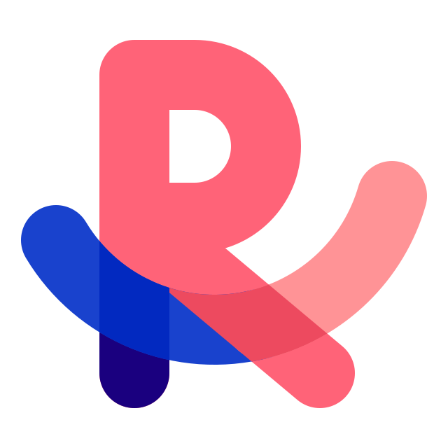

<p align="center">
  
</p>

<h1 align="center">Radian</h1>

<p align="center">
  <b>An open-source macOS browser that looks, feels and works like Arc.</b>
</p>

<p align="center">
  <a href="LICENSE"></a>
  
  <a href="package.json"></a>
  <a href="https://github.com/amsultan2010/radian-browser/actions/workflows/tests.yml"></a>
</p>

Radian is a Chromium browser for the Mac that recreates Arc: the same sidebar,
Spaces, Command Bar, shortcuts, menus, themes and motion. The goal is simple: an
Arc user should be able to switch to Radian and not notice the difference,
apart from the name, logo, icons and sounds.

It is just a browser. No AI features, no account and no sync for now.

---

## Why Radian

The Browser Company announced on 2026-10-22 that Arc is shutting down. **Arc
stops working on 2026-12-22.** Many people built their whole way of working
around its sidebar, Spaces and shortcuts, and there is no drop-in replacement.

Radian aims to be that replacement, and to stay open source so it can't be
taken away again. Behaviour is matched by watching Arc run and measuring it
frame by frame, never by reading Arc's code or reusing its assets.

## Features

Most of what works today comes from [Orbe](https://github.com/amadoubaui/orbe),
the MIT-licensed Arc-style browser Radian is built on. Radian's own work so far
is the English interface with Arc's menu wording, and layout, colours and motion
re-measured against Arc 1.170. Progress against Arc, feature by feature, is in
[docs/parity/features.md](docs/parity/features.md).

<table>
<tr><td><b>Sidebar and Spaces</b></td><td>Favorites tiles, pinned tabs, folders and Today tabs, with drag and drop and rename in place. Resizable, hidden with ⌘S and revealed by hovering the left edge. Spaces with their own icon, theme and profile, switched with ⌃1–⌃9, ⌥⌘←/→ or a two-finger swipe. Profiles keep cookies, logins and favorites apart.</td></tr>
<tr><td><b>Tabs</b></td><td>⌘W archives a tab and ⇧⌘T brings it back. Idle Today tabs archive themselves after 12 hours, and ⇧⌘K clears Today. ⌘D pins and unpins, ⌃Tab switches between recent tabs, and old tabs are put to sleep. Several windows share the same sidebar.</td></tr>
<tr><td><b>Command Bar</b></td><td>⌘T and ⌘L open one bar for addresses, search, open tabs, history, actions (with their shortcuts) and search suggestions, styled like Arc's.</td></tr>
<tr><td><b>Peek, Split View and Little Radian</b></td><td>Links leaving a pinned tab, or ⇧-clicked links, open in Peek over the page; ⌘O turns the Peek into a tab. Split View holds up to four panes (⌃⇧= / ⌃⇧-). Little Radian (⌥⌘N) opens a small window with Arc's tinted frame and "open in Space" button. Incognito windows with ⇧⌘N.</td></tr>
<tr><td><b>Themes and motion</b></td><td>A gradient theme per Space: one to three colours picked on a colour field, intensity, four textures (grain, sand, tweed, denim), light, dark or automatic, and pages of ready-made swatches, the first one matching Arc's picker. Text stays readable on any colour (contrast of at least 4.5:1). Pages can read the theme through <code>--arc-*</code> CSS variables. Rows slide, tabs glow while loading, lists bounce, and Reduce Motion is respected.</td></tr>
<tr><td><b>Library, Easels, Notes and Boosts</b></td><td>The Library holds history, the archive, downloads and media. Easels (⌃⇧E) are infinite canvases for text, images, shapes, arrows and sticky notes, and ⌥⇧⌘2 captures part of a page onto one. Notes (⌃⇧N). Boosts restyle a site with your own CSS, and Zap hides an element. Page capture, a mini media player in the sidebar and automatic Picture in Picture.</td></tr>
<tr><td><b>Extensions</b></td><td>Install from the Chrome Web Store, with signatures checked. Extension buttons sit under the address, with a side panel. Tested on real pages with Dark Reader, Wappalyzer, uBlock Origin Lite, CSS Peeper and GoFullPage.</td></tr>
<tr><td><b>Import from Arc</b></td><td><i>Radian → Import from Arc…</i> brings over Spaces, pinned tabs, folders, favorites and profiles. Run it again later and it updates Radian from Arc without deleting anything, after a backup. A second step brings over Arc's history, saved passwords and logins. Bookmarks import from Chrome, Brave, Edge, Vivaldi, Opera, Firefox and Safari.</td></tr>
<tr><td><b>Privacy</b></td><td>A built-in ad and tracker blocker (about 24,000 domains) with per-site exceptions. A password manager encrypted with the macOS keychain, with CSV import and export. Copied URLs lose their tracking parameters. Per-site permissions.</td></tr>
</table>

## Status

**Early.** Radian is a fresh fork, and the Arc-parity work is under way. The
plan, its phases and the rules the project follows are in
[docs/plan.md](docs/plan.md).

- Done: fork of Orbe, rename to Radian, English by default with Arc's menu
  wording, new logo and app icon, Arc-measured layout, colours, theme picker,
  Command Bar, Little Radian and motion. See [CHANGELOG.md](CHANGELOG.md).
- Next: measuring the rest of Arc before it shuts down, then visual and motion
  parity surface by surface, then the remaining feature gaps.
- Not planned for now: accounts, sync, AI features, Windows. Orbe's Windows
  build is still in the code and in CI, but Radian only targets macOS (Apple
  Silicon first).

## Install

There are no signed releases yet. Signed and notarized builds will come once
the project has an Apple Developer account. Until then, build Radian from
source:

```sh
git clone https://github.com/amsultan2010/radian-browser.git
cd radian-browser
npm run build -- --install   # builds Radian.app and copies it to /Applications
```

The build is ad-hoc signed and not notarized, which is enough to run it on the
Mac that built it. To bring your Arc setup over, use **Radian → Import from
Arc…**.

## Development

You need macOS and [Node.js](https://nodejs.org) 20 or newer. There are no npm
dependencies and no build step: plain JavaScript, HTML and CSS.

```sh
npm start          # run Radian from source
npm test           # end-to-end tests
npm run test:ui    # Playwright UI tests with real mouse and keyboard input
npm run test:ext   # extension API tests, in the real browser
npm run build      # builds ~/.orbe-dev/dist/Radian.app
```

- On first run, Electron (the version pinned under `"orbe"` in
  `package.json`) is downloaded into `~/.orbe-dev`, outside the project. The
  UI tests install `playwright-core` there too.
- **Protected video (Widevine):** `ORBE_DRM=1 npm start` uses the castLabs
  build of Electron, installed into `~/.orbe-dev-drm`.
- Test windows on macOS are invisible and don't take the mouse or keyboard, so
  you can keep working; `ORBE_TEST_VISIBLE=1` shows them. `ORBE_BACKGROUND=1`
  (development only) also keeps Radian out of the Dock and never takes focus.
- Browser data lives in `~/Library/Application Support/Radian`.

Internal names such as `ORBE_*` and `~/.orbe-dev` come from Orbe and are kept
for now.

## Keyboard shortcuts

Radian uses Arc's shortcuts. The full list is in *Help → Essential Keyboard
Shortcuts*, and you can change them in *Settings → Keyboard shortcuts*.

| Action | Shortcut |
| --- | --- |
| New tab / Command Bar | ⌘T / ⌘L |
| Archive tab / reopen it | ⌘W / ⇧⌘T |
| Pin or unpin tab | ⌘D |
| Next / previous tab | ⌥⌘↓ / ⌥⌘↑ |
| Recent tabs | ⌃⇥ |
| Go to tab 1–9 | ⌘1 – ⌘9 |
| Next / previous Space | ⌥⌘→ / ⌥⌘← |
| Go to Space 1–9 | ⌃1 – ⌃9 |
| Hide sidebar / show toolbar | ⌘S / ⇧⌘D |
| Add split view / close pane | ⌃⇧= / ⌃⇧- |
| Copy URL / as Markdown | ⇧⌘C / ⌥⇧⌘C |
| Clear Today | ⇧⌘K |
| Little Radian / Incognito | ⌥⌘N / ⇧⌘N |
| History / Library / Downloads | ⌘Y / ⇧⌘L / ⇧⌘J |
| Capture / capture to Easel | ⇧⌘2 / ⌥⇧⌘2 |
| New Easel / new Note | ⌃⇧E / ⌃⇧N |
| Settings | ⌘, |

## Project structure

```
src/main/       main process: windows, tabs, menus, data
src/preload/    bridge between the interface and the main process
src/renderer/   interface: sidebar, Command Bar, internal pages
src/shared/     interface text (English and French)
scripts/        dev, build, test runners and asset generators
tests/          end-to-end, UI (Playwright) and real-site tests
assets/         app icon and ad blocker list
brand/          Radian logo
docs/           plan, Arc parity specs, research and Orbe's original docs
```

Orbe's code, comments and docs are in French. They are translated to English
as files are touched, never in bulk. See [docs/README.md](docs/README.md) for
the docs index.

## Contributing

Contributions are welcome, especially reports of where Radian behaves
differently from Arc. Read [CONTRIBUTING.md](CONTRIBUTING.md) first. One rule
matters above the others: **behaviour comes from observing Arc, never from its
code or assets.**

- Found a bug? [Open a bug report](https://github.com/amsultan2010/radian-browser/issues/new?template=bug_report.yml).
- Radian differs from Arc? [Report an Arc difference](https://github.com/amsultan2010/radian-browser/issues/new?template=arc_parity.yml).
- Everyone taking part follows the [Code of Conduct](CODE_OF_CONDUCT.md).

## Security

Please don't report security issues in public. Use
[GitHub Security Advisories](https://github.com/amsultan2010/radian-browser/security/advisories/new)
and see [SECURITY.md](SECURITY.md).

## License

Radian is released under the [MIT License](LICENSE). It keeps Orbe's copyright
notice, as Orbe's MIT license requires. The ad blocker list
(`assets/blocklist.txt`) combines public lists that keep their own licenses
(MIT and CC BY 3.0), noted at the top of the file. Third-party credits are in
[NOTICE](NOTICE).

## Acknowledgements

- [**Orbe**](https://github.com/amadoubaui/orbe) by Amadou Ba (PIXEWORK).
  Radian starts from Orbe's code, and most
  of its features are Orbe's work. Thank you, Amadou.
- [**Electron**](https://www.electronjs.org) and
  [**Chromium**](https://www.chromium.org), the engine underneath.
- [**castLabs Electron for Content Security**](https://github.com/castlabs/electron-releases),
  the Electron build with Widevine used for protected video.
- [**The Browser Company**](https://thebrowser.company), whose design for Arc
  inspired this project.

## Trademarks

Radian is an independent project. It is not affiliated with, endorsed by or
sponsored by The Browser Company. Arc is a trademark of The Browser Company.
Radian contains no code, icons, images, sounds or other assets from Arc.
